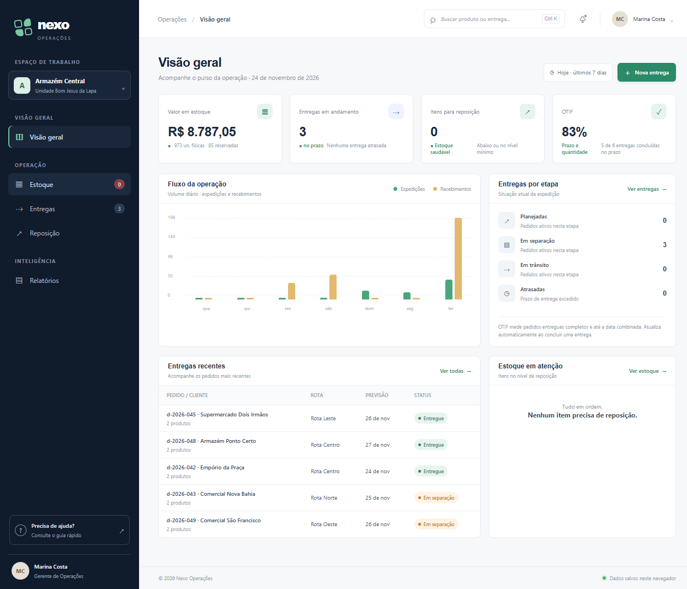
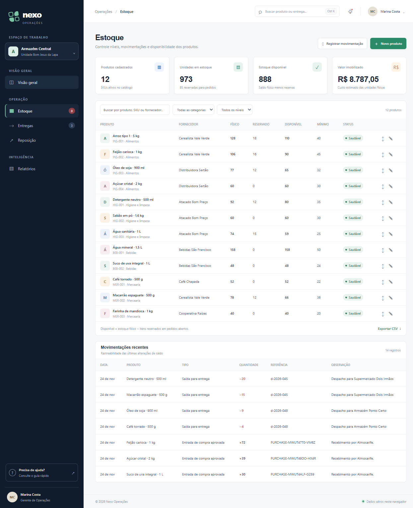
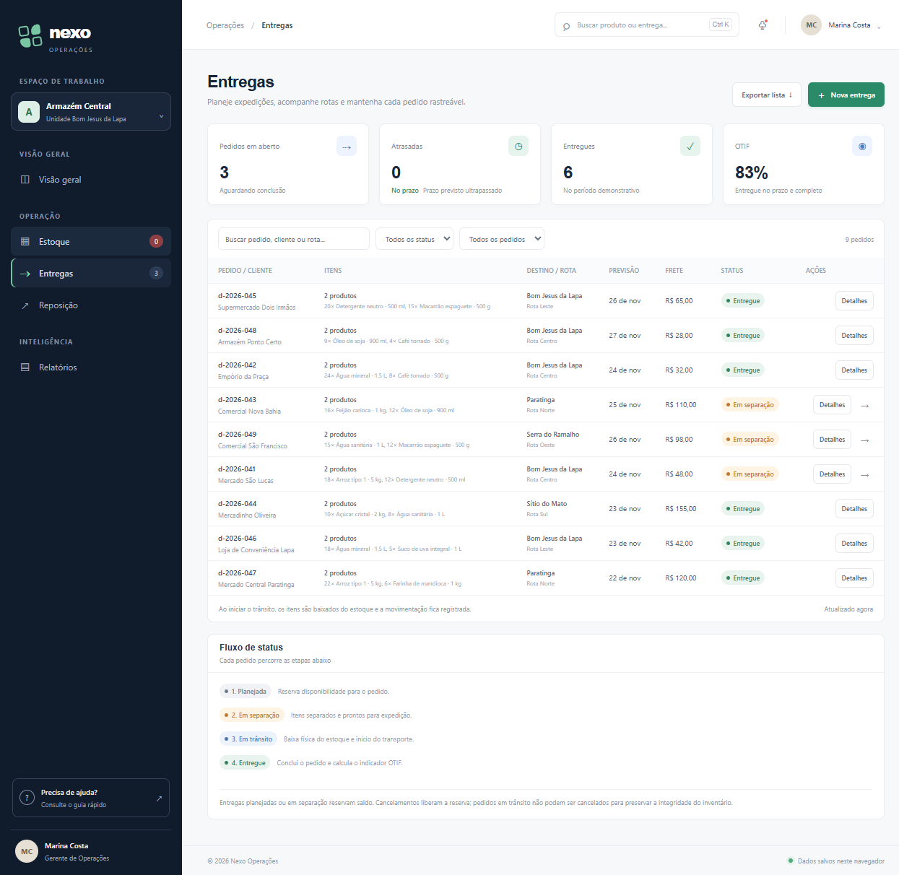
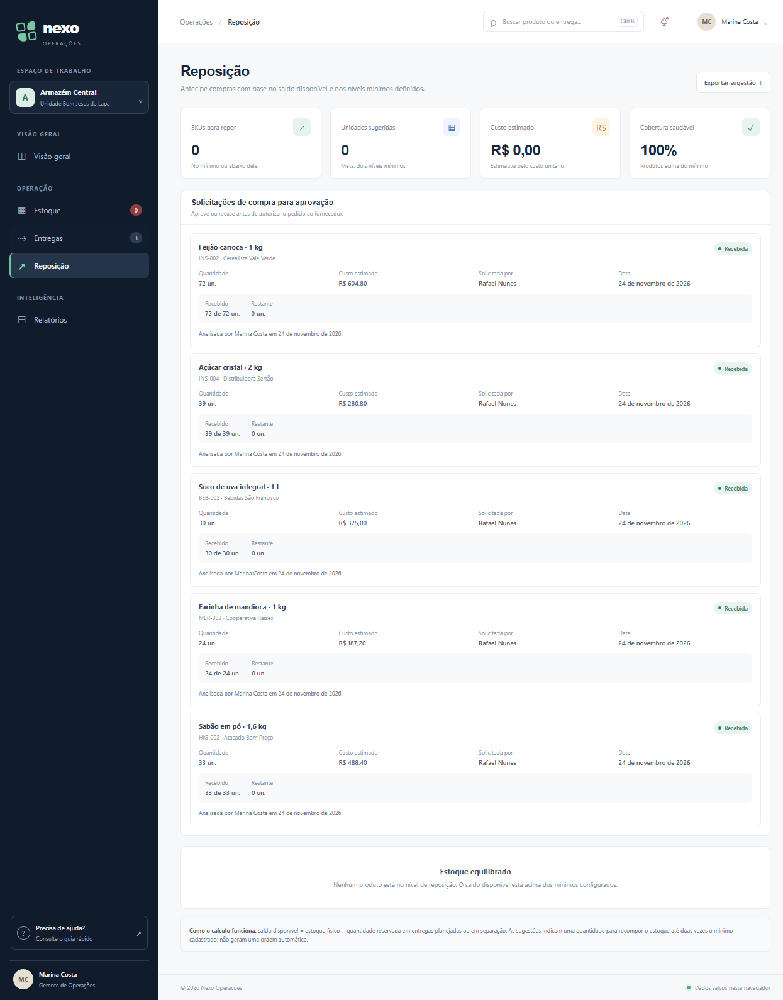
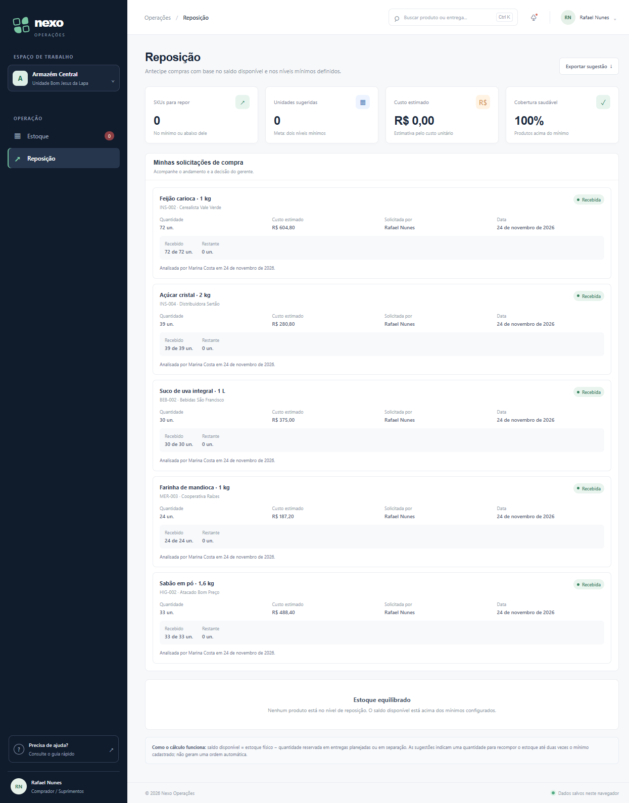
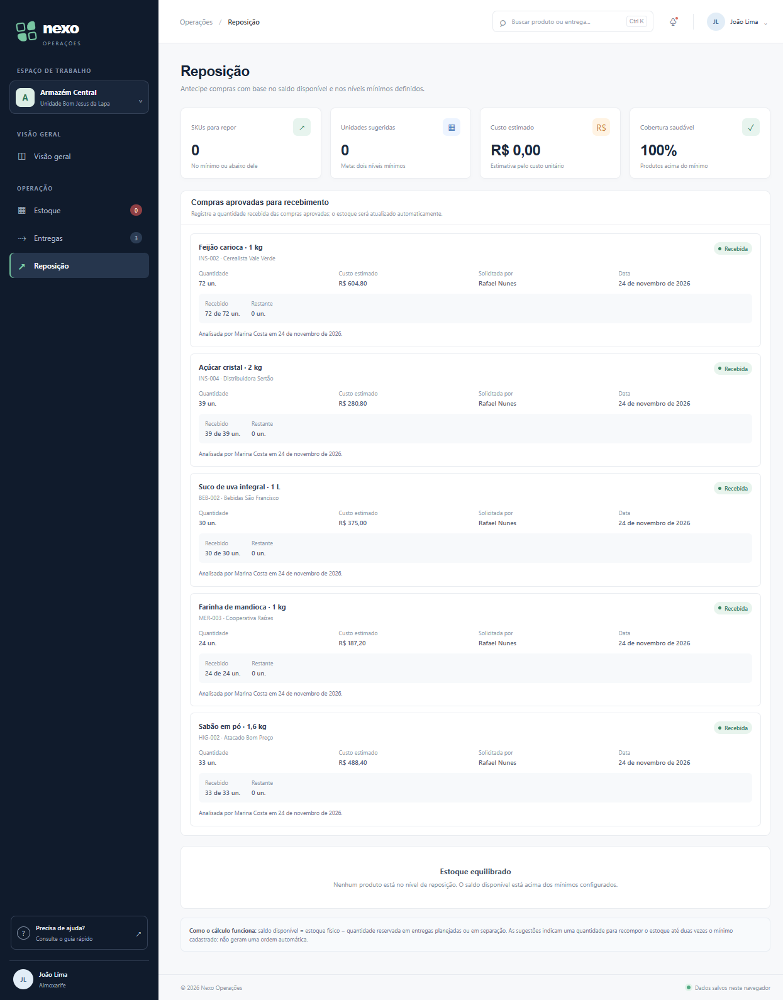
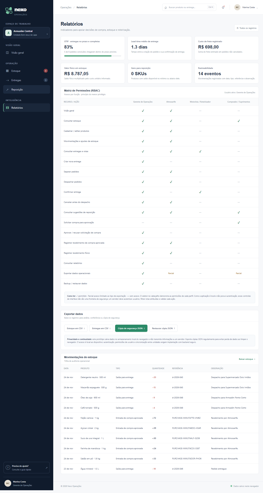

# Nexo — Solução de TI e projeto do produto

**Sistema:** gestão de estoque, compras e entregas  
**Unidade demonstrativa:** Armazém Central — Bom Jesus da Lapa  
**Versão:** 1.0  
**Tipo:** protótipo funcional para atividade acadêmica

> Os cadastros, produtos, pedidos e valores exibidos pelo protótipo são dados demonstrativos. Este documento descreve o que está implementado e separa explicitamente as melhorias ainda planejadas.

## 1. Contexto e problema

O cenário da atividade é uma operação de distribuição que precisa coordenar estoque, compras e entregas. Quando essas rotinas dependem de anotações ou controles separados, surgem riscos de divergência de saldo, falta de produtos, compras sem aprovação, dificuldade para acompanhar recebimentos e pouca visibilidade sobre pedidos atrasados.

### Gargalos priorizados

1. **Saldo pouco confiável:** entradas e saídas sem histórico dificultam saber quanto existe, quanto está reservado e quanto pode ser prometido.
2. **Reposição sem fluxo de aprovação:** uma necessidade de compra pode ser solicitada sem justificativa, acompanhamento ou validação gerencial.
3. **Recebimento desconectado da compra:** aprovar uma solicitação não deve aumentar o estoque; é necessário registrar o que efetivamente chegou.
4. **Entrega sem acompanhamento consistente:** datas, rota, itens e etapa do pedido precisam estar acessíveis às pessoas responsáveis.
5. **Indicadores dispersos:** sem medidas operacionais, fica mais difícil priorizar reposições e identificar atrasos.

## 2. Solução proposta

O **Nexo** é um protótipo web responsivo que reúne cadastro e consulta de produtos, movimentações de estoque, solicitações de compra com aprovação, recebimento de compras, planejamento de entregas e indicadores operacionais.

O produto busca:

- manter o saldo físico separado das quantidades reservadas;
- registrar movimentos de entrada e saída com data, referência e observação;
- exigir aprovação do Gerente de Operações antes de autorizar uma solicitação de compra;
- disponibilizar compras aprovadas para recebimento pelo Almoxarife ou Gerente;
- atualizar o estoque pela quantidade efetivamente recebida, inclusive em recebimentos parciais;
- acompanhar as etapas de uma entrega e registrar a baixa ao despachar;
- disponibilizar uma matriz RBAC e um seletor rápido de perfis para demonstração.

### Rotina operacional representada

1. O sistema calcula o saldo disponível: **estoque físico − reservas de entregas abertas**.
2. Produtos no mínimo ou abaixo dele aparecem em **Reposição**, com quantidade sugerida para recompor o saldo disponível até a meta calculada a partir do mínimo.
3. Rafael, no perfil **Comprador / Suprimentos**, envia a solicitação com quantidade e justificativa.
4. Marina, no perfil **Gerente de Operações**, aprova ou recusa. A aprovação é interna: não envia pedido ao fornecedor nem altera o estoque.
5. Após a aprovação, João, no perfil **Almoxarife**, registra o recebimento total ou parcial. Cada recebimento aumenta o saldo físico e cria uma movimentação vinculada à solicitação.
6. Uma entrega planejada reserva unidades disponíveis. Ao despachar, o sistema baixa os itens do saldo físico e registra as saídas; a entrega pode então ser confirmada.

## 3. Projeto do produto

### 3.1 Nome e proposta de valor

**Nexo** representa a conexão entre os processos de estoque, suprimentos e expedição. A proposta é oferecer uma visão simples e compartilhada do fluxo operacional, desde a identificação da necessidade de reposição até o recebimento e a entrega.

### 3.2 Perfis de usuário

| Perfil demonstrativo | Responsabilidade no sistema |
|---|---|
| **Gerente de Operações — Marina Costa** | Acompanha indicadores, mantém produtos, movimenta estoque, cria e administra entregas, aprova ou recusa compras, registra recebimentos e gerencia exportação/backup. |
| **Almoxarife — João Lima** | Mantém o catálogo e o estoque, registra movimentos e recebimentos, separa e despacha pedidos e cancela entregas antes do despacho. |
| **Motorista / Roteirizador — Ana Souza** | Consulta entregas e rotas cadastradas e confirma entregas que já estão em trânsito. |
| **Comprador / Suprimentos — Rafael Nunes** | Consulta estoque e sugestões de reposição, exporta os dados permitidos e envia e acompanha solicitações de compra. Não altera o saldo nem aprova a própria solicitação. |

### 3.3 Matriz de permissões (RBAC)

Legenda: **✓** permitido; **Parcial** acesso limitado às exportações daquele perfil; **—** sem permissão.

| Recurso / ação | Gerente | Almoxarife | Motorista / Roteirizador | Comprador / Suprimentos |
|---|:---:|:---:|:---:|:---:|
| Visão geral | ✓ | ✓ | — | — |
| Consultar estoque | ✓ | ✓ | — | ✓ |
| Cadastrar / editar produtos | ✓ | ✓ | — | — |
| Movimentações manuais de estoque | ✓ | ✓ | — | — |
| Consultar entregas e rotas | ✓ | ✓ | ✓ | — |
| Criar entrega | ✓ | — | — | — |
| Separar / despachar entrega | ✓ | ✓ | — | — |
| Confirmar entrega em trânsito | ✓ | — | ✓ | — |
| Cancelar antes do despacho | ✓ | ✓ | — | — |
| Consultar reposição | ✓ | ✓ | — | ✓ |
| Solicitar compra para aprovação | — | — | — | ✓ |
| Aprovar / recusar compra | ✓ | — | — | — |
| Registrar recebimento de compra aprovada | ✓ | ✓ | — | — |
| Consultar relatórios e matriz RBAC | ✓ | — | — | — |
| Exportar dados operacionais | ✓ | Estoque | — | Estoque e reposição |
| Fazer / restaurar backup JSON | ✓ | — | — | — |

O seletor rápido no cabeçalho troca entre os quatro perfis demonstrativos. Essa troca demonstra a experiência de permissões na interface; não constitui autenticação nem controle de segurança real.

### 3.4 Requisitos funcionais implementados

| ID | Requisito |
|---|---|
| RF01 | Cadastrar e editar produtos com SKU, nome, categoria, fornecedor, custo unitário e estoque mínimo. O saldo inicial informado no cadastro é registrado como entrada. |
| RF02 | Consultar saldo físico, reservado e disponível, pesquisar produtos e filtrar por categoria e nível de estoque. |
| RF03 | Registrar entrada/recebimento, saída avulsa e ajuste positivo, com data, referência e observação; impedir saída acima do saldo disponível. |
| RF04 | Sinalizar itens no mínimo ou abaixo dele e sugerir quantidade para atingir a meta `max(2 × mínimo, mínimo + 1)`, considerando o saldo disponível. |
| RF05 | Permitir que o Comprador solicite compra com quantidade e justificativa; exibir o estado da solicitação para acompanhamento. |
| RF06 | Permitir ao Gerente aprovar ou recusar solicitações. Uma solicitação ativa por produto impede a criação de outra até ser recusada ou totalmente recebida. |
| RF07 | Permitir que o Almoxarife ou Gerente registre recebimentos totais ou parciais de compras aprovadas. O estoque e o histórico são atualizados pela quantidade recebida. |
| RF08 | Planejar entregas com cliente, endereço, município, rota informada, previsão, frete, observações e itens; validar saldo e reservar as quantidades. |
| RF09 | Acompanhar os estados **Planejada → Em separação → Em trânsito → Entregue**. O despacho baixa o estoque e registra movimentos; cancelamentos antes do despacho liberam as reservas. |
| RF10 | Exibir indicadores operacionais, relatórios, matriz de permissões, exportação CSV e backup/restauração JSON conforme o perfil. |

### 3.5 Requisitos não funcionais e limites

- **Usabilidade:** interface em português, responsiva, com pesquisa, filtros, mensagens de validação e navegação por perfil.
- **Integridade operacional:** quantidades devem ser inteiras e positivas; entregas e saídas não podem consumir saldo indisponível; movimentos de recebimento registram o saldo efetivamente incorporado.
- **Persistência demonstrativa:** dados salvos no `localStorage` do navegador atual; não há sincronização entre dispositivos.
- **Segurança:** permissões e seletor são controles de interface. Não há login, contas individuais, validação de autorização em servidor ou isolamento real entre perfis.
- **Continuidade:** o backup JSON é manual; não existe cópia automática nem garantia contra perda dos dados do navegador.
- **Escopo de entrega:** a rota é texto informado pelo usuário. Não há cálculo automático de rota, mapa ou geolocalização; o perfil de motorista vê a fila completa, sem filtro por atribuição individual.

### 3.6 Fluxo de dados e estados

| Processo | Dados principais | Resultado |
|---|---|---|
| Cadastro de produto | SKU, nome, categoria, fornecedor, custo, mínimo e saldo inicial | Produto disponível no catálogo; eventual saldo inicial gera movimento. |
| Movimento manual | Produto, tipo, quantidade, data, referência e observação | Saldo atualizado e evento incluído no histórico. |
| Solicitação de compra | Produto, fornecedor, quantidade, custo estimado, solicitante e justificativa | Solicitação **Aguardando aprovação**. |
| Análise gerencial | Decisão, responsável pela análise e data | Solicitação **Aprovada** ou **Recusada**; aprovação não envia pedido ao fornecedor nem altera o saldo. |
| Recebimento de compra | Quantidade recebida, total/parcial, data e referência | Estado **Recebimento parcial** ou **Recebida**; saldo e movimento atualizados. |
| Entrega | Cliente, endereço, rota, previsão, frete, itens e quantidades | Reserva ao planejar; baixa física ao iniciar o trânsito; conclusão registra a data de entrega. |

## 4. Telas do protótipo

As capturas abaixo foram feitas no protótipo com dados demonstrativos. Elas ilustram as páginas e os perfis atualmente implementados.

### 4.1 Visão geral

Resumo do valor físico em estoque, entregas em andamento, itens para reposição e indicador OTIF, além do fluxo dos últimos sete dias, etapas de entrega e itens em atenção.

### 4.2 Estoque

Exibe catálogo, saldo físico, reservado e disponível, mínimo configurado, filtros e movimentações recentes.

### 4.3 Entregas

Apresenta pedidos, destino, rota informada, previsão, frete, status e ações compatíveis com o perfil ativo.

### 4.4 Reposição — Gerente de Operações

O painel lista as solicitações e seus estados. Quando há pedidos pendentes, o Gerente pode aprovar ou recusar; compras aprovadas ficam disponíveis para recebimento e a aprovação não altera o estoque. A captura usa registros demonstrativos que já constam como recebidos.

### 4.5 Reposição — Comprador / Suprimentos

O Comprador visualiza as solicitações e seus estados. A ação de solicitar aparece em produtos que precisam de reposição e não têm outra compra ativa; a captura mostra o histórico de dados demonstrativos já recebidos.

### 4.6 Reposição — Almoxarife

O Almoxarife visualiza compras aprovadas e o progresso do recebimento. Enquanto houver quantidade pendente, pode registrar recebimento total ou parcial; a captura mostra o histórico de compras já recebidas.

### 4.7 Relatórios e matriz RBAC

Indicadores disponíveis e matriz que documenta as ações permitidas para cada perfil.

## 5. Dados e indicadores

### 5.1 Dados mantidos pelo protótipo

- **Produto:** SKU, nome, categoria, fornecedor principal, custo unitário, estoque físico e mínimo.
- **Movimentação:** produto, tipo, quantidade, data, referência e observação.
- **Solicitação de compra:** produto, fornecedor e custo registrados, quantidade, justificativa, solicitante, estado, análise e quantidade recebida.
- **Entrega:** cliente, destino, município, rota, previsão, frete, observações, itens e quantidades, estado e data de conclusão.

O histórico de movimentos não registra de forma uniforme uma identidade autenticada do usuário que executou cada ação. A trilha é operacional e demonstrativa, não um log de auditoria imutável.

### 5.2 Indicadores

| Indicador | Cálculo / interpretação no protótipo |
|---|---|
| Valor físico em estoque | Soma de estoque físico × custo unitário informado. |
| Estoque disponível | Saldo físico menos quantidades reservadas em entregas planejadas ou em separação. |
| Itens para reposição | Produtos cujo saldo disponível é igual ou inferior ao mínimo configurado. |
| Quantidade sugerida | `max(0, max(2 × mínimo, mínimo + 1) − saldo disponível)`. |
| Entregas em aberto / atrasadas | Pedidos ainda não concluídos ou cancelados; atraso comparado à data prevista. |
| OTIF | Percentual de pedidos concluídos até a data prevista. O protótipo não registra entrega parcial por item; a métrica assume que um pedido marcado como entregue foi atendido integralmente. |
| Lead time médio de entrega | Média de dias entre a criação do pedido e sua confirmação como entregue. |
| Custo de frete registrado | Soma dos valores estimados de frete em pedidos não cancelados; não equivale a custo financeiro conciliado. |
| Fluxo de expedição e recebimento | Quantidades de movimentos de entrada e expedição nos últimos sete dias. |

Não são calculados giro de estoque, acuracidade de inventário, previsão de demanda, custo real de aquisição, distância de rota ou desempenho individual de motoristas.

## 6. Tecnologias e integrações

### Implementado

- **Interface:** HTML, CSS e JavaScript no navegador.
- **Execução:** abrir `index.html` em um navegador moderno; não requer instalação de pacotes nem servidor para a demonstração.
- **Persistência:** `localStorage` do navegador.
- **Exportação:** arquivos CSV para conjuntos de dados permitidos pelo perfil e cópia/restauração manual em JSON para o Gerente.
- **Integrações externas:** nenhuma. O protótipo não envia dados a servidores ou serviços externos.

### Evoluções possíveis — não implementadas

- backend com banco de dados, autenticação individual e autorização no servidor;
- sincronização entre unidades e notificações de aprovação/recebimento;
- integração com ERP, fornecedores, pedidos de compra e documentos fiscais;
- integração com mapas, roteirização automática, GPS e transportadoras;
- leitura de código de barras, lote, validade e contagem cíclica;
- histórico de auditoria com autoria, trilha protegida e relatórios avançados;
- previsão de demanda, níveis de segurança calculados por prazo de fornecedor e entregas parciais por item.

## 7. Dados, privacidade e segurança

O protótipo é local: os dados ficam no navegador do dispositivo e não são transmitidos a um servidor. O seletor de usuário é aberto e os perfis compartilham o mesmo armazenamento. Portanto, **não se deve usar o protótipo como sistema multiusuário ou armazenar nele dados pessoais/comerciais sensíveis**.

Para uso real, a aplicação precisa de autenticação individual, autorização validada no servidor em cada operação, isolamento por unidade, comunicação protegida, cópias de segurança controladas, registro de autoria e política de retenção. A matriz RBAC existente serve como especificação inicial de permissões, não como barreira contra acesso indevido.

Se dados pessoais forem introduzidos numa futura implantação, o tratamento deverá ser avaliado conforme a legislação aplicável, incluindo a Lei Geral de Proteção de Dados Pessoais (Lei nº 13.709/2018). Os dados iniciais deste protótipo são demonstrativos.

## 8. Referências

- Documento de referência da atividade anexado pelo usuário: estrutura de contexto, proposta, requisitos, fluxos, telas, indicadores, integrações e cuidados com dados.
- BRASIL. **Lei nº 13.709, de 14 de agosto de 2018**. Lei Geral de Proteção de Dados Pessoais (LGPD).
- BALLOU, Ronald H. *Gerenciamento da cadeia de suprimentos / logística empresarial*.
- CHOPRA, Sunil; MEINDL, Peter. *Gestão da cadeia de suprimentos*.
- SLACK, Nigel; BRANDON-JONES, Alistair; JOHNSTON, Robert. *Administração da produção*.

